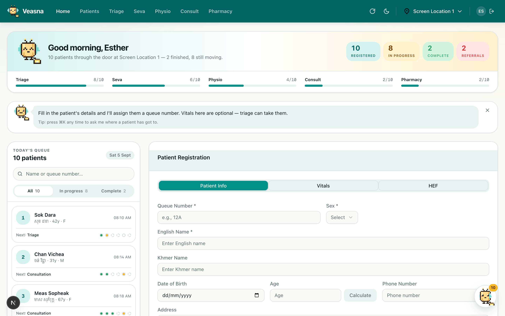

<div align="center">


# Veasna

**An electronic medical record built for pop-up health screenings.**

Registration to pharmacy in one place — and always a clear answer to
*“where has this patient got to?”*

[](https://nextjs.org)
[](https://react.dev)
[](https://www.typescriptlang.org)
[](https://tailwindcss.com)
[](https://electronjs.org)

</div>

<div align="center">
  
</div>

---

## What this is

Veasna was built for student volunteers running community health screenings with
**Project Battambang** in Cambodia. A screening day is a pop-up clinic: a few
hundred people arrive, pass through a handful of stations set up in a hall or a
schoolyard, and leave the same day. There is often no reliable internet, and the
people running each station are volunteers who may never have used the system
before.

That shapes everything here. The app runs on a laptop on a local network, keeps
working when the link is flaky, and tries to teach itself to whoever is sitting
in front of it.

## The screening journey

Every patient moves through the same set of stations, and the app treats that
journey as the thing it is actually tracking:

```
Registration → Triage → Seva → Physiotherapy → Consultation → Pharmacy
```

| Station | What happens |
| --- | --- |
| **Registration** | Patient details captured, queue number issued |
| **Triage** | Vitals, presenting complaint, medical history, visual acuity |
| **Seva** | Eye screening, Snellen with and without pinhole, refraction follow-up |
| **Physiotherapy** | Pain mapping on a body chart, assessment notes |
| **Consultation** | Doctor's assessment, prescription, referral flagging |
| **Pharmacy** | Dispensing against the prescription, live stock levels |

Seva, physiotherapy and pharmacy are optional — not every patient needs them, and
the progress model knows that.

## Features

- **Live station progress.** Every queue row, search result and patient record
  shows how far that patient has got. The backend has no status column;
  completion is derived from which per-visit records exist, in one place, so
  every screen agrees.
- **A queue assistant you can talk to.** Press <kbd>⌘K</kbd> (or click the
  mascot) and ask in plain language: *“status of 12A”*, *“who's waiting for
  consult?”*, *“any referrals today?”*. Answered entirely in the browser — no
  model call, no dependency, no round trip. See [below](#the-assistant).
- **In-flow coaching.** The mascot gives each station a short, situation-aware
  line — what to do here, what's blocking, what's next — so a volunteer can work
  out the flow without being trained on it first.
- **Multi-site.** Screening locations are first-class; everything is filtered by
  the site you're at, and the selection persists locally until 6am the next day.
- **Resilient fetching.** Patient and visit requests revalidate with ETags and
  fall back to their last cached response when a request fails, so a dropped
  link degrades to stale data rather than an error screen.
- **Light and dark themes**, driven entirely by design tokens.
- **Runs as a desktop app** via Electron, or in any browser on the network.

## Veasna the firefly

Veasna is a chatbot curated deliberately small: no NLP library, no model, no network call at
answer time. Its entire runtime dependency closure is **three source files and
zero npm packages**.

It works in three layers:

1. **Fetch** — pull today's queue and each visit record (concurrency-capped,
   ETag-revalidated).
2. **Interpret** — `deriveStatus()` turns a visit into per-station completion.
   This is the single source of truth for what "done" means.
3. **Answer** — `respond(text, context)` is a pure function over data the app has
   already loaded. It normalises the text, extracts any queue number, patient
   name or station mentioned, scores eleven intents by keyword hits, and hands
   the winner a handler.

Because answering touches no network, the assistant keeps working on a bad link —
it just answers from the last queue it managed to sync.

## Tech stack

**Frontend** — Next.js 15 (App Router), React 19, TypeScript, Tailwind CSS 4,
Zustand for state (with persisted, TTL-expiring local storage), Radix UI
primitives, Electron for desktop packaging.

**Backend** — Node/Express + PostgreSQL, in a separate repository:
[**Runus01/veasna-backend**](https://github.com/Runus01/veasna-backend).

The mascot is hand-drawn as a 20×20 character grid and painted with the raw
canvas 2D context — no sprite sheets and no animation library.

## Getting started

### Prerequisites

- Node.js 20+
- A running [Veasna backend](https://github.com/Runus01/veasna-backend) with its
  PostgreSQL database

### Setup

```bash
git clone https://github.com/jowhee3011/veasna-frontend.git
cd veasna-frontend
npm install
```

Create `.env` in the project root and point it at your backend:

```env
NEXT_PUBLIC_BACKEND_URL=http://localhost:3000
```

### Run

```bash
npm run dev
```

The app starts on **http://localhost:3001** (the backend is expected on `3000`).

Sign in with any name — there are no passwords. Names identify who recorded each
entry, and typing a new one creates that user. Then pick a screening site from
the location menu in the top bar; every page is filtered by it.

### Desktop app

With the dev server already running:

```bash
npm run electron
```

Electron loads `http://localhost:3001` by default. Override with the `VEASNA_URL`
environment variable to point it somewhere else.

### Scripts

| Script | Purpose |
| --- | --- |
| `npm run dev` | Dev server on port 3001 (Turbopack) |
| `npm run build` | Production build |
| `npm start` | Serve the production build |
| `npm run lint` | ESLint |
| `npm run electron` | Launch the desktop shell |

> **Deploying to a screening site:** `npm start` currently binds to a hard-coded
> host address in `package.json`. Change the `-H` flag to the LAN IP of the
> machine serving the app, so other laptops at the site can reach it.

## Project structure

```
src/
├─ app/
│  ├─ (auth)/login/           Sign-in
│  └─ (main)/                 Station pages, sharing a nav + assistant shell
│     ├─ page.tsx             Home: today's queue + registration
│     ├─ triage/  seva/  physiotherapy/  doctors-consultation/
│     ├─ patient-list/  patient-details/
│     └─ pharmacy/
├─ components/
│  ├─ mascot/                 Sprite renderer, coach, chat panel, progress rail
│  ├─ shared/                 Station shells, search, read-only panels
│  └─ ui/                     Radix-based primitives
├─ lib/
│  ├─ mascot/                 sprite.ts · stations.ts · chat-engine.ts
│  ├─ api/                    Typed request layer, ETag caching
│  └─ types/                  Shared domain types
└─ stores/                    Zustand: user, location, location data, screening
```

Three files carry most of the product logic worth reading first:

- **`lib/mascot/stations.ts`** — the journey model and `deriveStatus()`
- **`lib/mascot/chat-engine.ts`** — the intent matcher
- **`app/globals.css`** — the design tokens both themes are built from

## Design

The palette is a calm jade/teal clinical base lit by a warm amber accent — the
mascot's lantern. Everything is expressed as CSS custom properties mapped into
Tailwind, so light and dark themes are the same components with a different token
set.

Motion is deliberately rationed. The mascot is still by default and animates only
where movement reports something: the assistant thinking, work loading, the
firefly moving to a new station.

## Acknowledgements

Built to support student organisers volunteering with Project Battambang.
